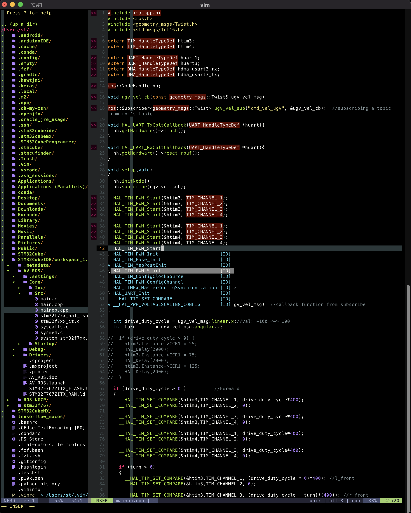

# .vim



Personal vim config (vim-plug) plus a one-file **offline installer** for machines
without network or sudo, e.g. an edge PC that only ships the stock `vi` (vim-tiny).

```
vimrc.vim                 config (~/.vimrc -> ~/.vim/vimrc.vim)
autoload/plug.vim         vim-plug
colors/                   colorschemes not managed by vim-plug
install.sh                install for the current user (no sudo, no network)
bundle.sh                 build dist/vim-offline.sh
tools/build-static-vim.sh build static (musl) vim for x86_64/aarch64 (no Docker/root)
docs/                     cheat sheet, screenshot
plugged/ build/ dist/     generated, gitignored
```

## Normal setup (machine with network)

```bash
git clone https://github.com/sontung1010/.vim.git ~/.vim
~/.vim/install.sh                 # links ~/.vimrc
vim +PlugInstall +qa              # fetch plugins into ~/.vim/plugged
```

After adding a `Plug '...'` line: save, restart vim, run `:PlugInstall`.

## Offline install (edge PC, no network, no sudo)

On the laptop (needs network the first time, ~250 MB of toolchains/sources cached in `build/`):

```bash
cd ~/.vim
./bundle.sh                       # -> dist/vim-offline.sh (~20 MB)
./bundle.sh --update              # same, but :PlugUpdate first
```

Copy the single file over and run it:

```bash
scp dist/vim-offline.sh edge:~
ssh edge sh vim-offline.sh
```

What it does on the target, all inside `$HOME`:

- copies config + plugins to `~/.vim` (an existing one is moved to `~/.vim.bak-<time>`), links `~/.vimrc`
- if there is no full vim (only vim-tiny or nothing), installs a static vim 9.2 to
  `~/.local/opt/vim` with `vim`, `vi`, `vimdiff`, `view` wrappers in `~/.local/bin`
- installs `fzf` for the vim plugin (and in `~/.local/bin` if missing)
- adds `~/.local/bin` to `PATH` in `~/.bashrc`

The static binaries have no runtime dependencies (musl + ncurses with built-in
terminfo for xterm/screen/tmux/linux), so they work on any Linux of that CPU
architecture (x86_64 PCs, aarch64 Jetson/RPi), regardless of distro or glibc version.

Installer options (pass after the file name, e.g. `sh vim-offline.sh --vim yes`):

| option | meaning |
|---|---|
| `--vim auto\|yes\|no` | install the static vim: only when no full vim exists (default), always, never |
| `--no-vi` | do not shadow `vi` with the static vim |
| `--prefix DIR` | install binaries under `DIR` instead of `~/.local` |
| `--extract [DIR]` | only unpack the bundle, do not install |

Uninstall: `rm -rf ~/.local/opt/vim ~/.local/bin/{vim,vi,vimdiff,view}` and remove
the `vim-offline` block from `~/.bashrc`.

## macOS

The stock vim lacks python3; use `brew install vim` (then `brew link vim`) and
reopen the terminal, then follow *Normal setup*.

## Bash setup
From this link: https://askubuntu.com/questions/851186/how-to-add-colored-git-branch-to-my-bash-prompt#:~:text=You%20only%20need%20to%20use,resets%20formatting%20on%20the%20text.
paste this in bashrc:

```bash
# show git branch in prompt
git_branch() {
    # -- Finds and outputs the current branch name by parsing the list of
    #    all branches
    # -- Current branch is identified by an asterisk at the beginning
    # -- If not in a Git repository, error message goes to /dev/null and
    #    no output is produced
    git branch --no-color 2>/dev/null | sed -e '/^[^*]/d' -e 's/* \(.*\)/\1/'
}

git_status() {
    # Outputs a series of indicators based on the status of the
    # working directory:
    # + changes are staged and ready to commit
    # ! unstaged changes are present
    # ? untracked files are present
    # S changes have been stashed
    # P local commits need to be pushed to the remote
    local status="$(git status --porcelain 2>/dev/null)"
    local output=''
    [[ -n $(egrep '^[MADRC]' <<<"$status") ]] && output="$output+"
    [[ -n $(egrep '^.[MD]' <<<"$status") ]] && output="$output!"
    [[ -n $(egrep '^\?\?' <<<"$status") ]] && output="$output?"
    [[ -n $(git stash list) ]] && output="${output}S"
    [[ -n $(git log --branches --not --remotes) ]] && output="${output}P"
    [[ -n $output ]] && output="|$output"  # separate from branch name
    echo $output
}

git_color() {
    # Receives output of git_status as argument; produces appropriate color
    # code based on status of working directory:
    # - White if everything is clean
    # - Green if all changes are staged
    # - Red if there are uncommitted changes with nothing staged
    # - Yellow if there are both staged and unstaged changes
    local staged=$([[ $1 =~ \+ ]] && echo yes)
    local dirty=$([[ $1 =~ [!\?] ]] && echo yes)
    if [[ -n $staged ]] && [[ -n $dirty ]]; then
        echo -e '\033[1;33m'  # bold yellow
    elif [[ -n $staged ]]; then
        echo -e '\033[1;32m'  # bold green
    elif [[ -n $dirty ]]; then
        echo -e '\033[1;31m'  # bold red
    else
        echo -e '\033[1;37m'  # bold white
    fi
}

git_prompt() {
    # First, get the branch name...
    local branch=$(git_branch)
    # Empty output? Then we're not in a Git repository, so bypass the rest
    # of the function, producing no output
    if [[ -n $branch ]]; then
        local state=$(git_status)
        local color=$(git_color $state)
        # Now output the actual code to insert the branch and status
        echo -e "\x01$color\x02[$branch$state]\x01\033[00m\x02"  # last bit resets color
    fi
}

# Sample prompt declaration based off of the default Ubuntu 14.04.1 color
# prompt. Tweak as you see fit, or just stick "$(git_prompt)" into your
# favorite prompt.
PS1='$debian_chroot\[\033[01;32m\]\u@\h\[\033[00m\]:\[\033[01;34m\]\w$(git_prompt)\[\033[00m\]\$ '

# Set history format to include timestamps
HISTTIMEFORMAT="%Y-%m-%d %T "

# fzf search, put this below the installation
[ -f ~/.fzf/shell/key-bindings.bash ] && source ~/.fzf/shell/key-bindings.bash

# notify training is complete
notify_done() {
  local rc=$?
  if [ $rc -eq 0 ]; then
    notify-send -u critical "Training finished" "${1:-done} ($(date +%H:%M))"
  else
    notify-send -u critical "Training FAILED (exit $rc)" "${1:-job} ($(date +%H:%M))"
  fi
  paplay /usr/share/sounds/freedesktop/stereo/complete.oga 2>/dev/null
  return $rc
}
```

## Zsh setup (careful when working with ROS)

- Install Homebrew for MacOS
- Install iTerm2 or Terminator
- Install zsh
- Install Oh-my-zsh:
```
https://github.com/ohmyzsh/ohmyzsh.git
```
- Install Powerlevel10k:
```
git clone https://github.com/romkatv/powerlevel10k.git $ZSH_CUSTOM/themes/powerlevel10k
```
-- Plugin zsh-autosuggestions:
```
https://github.com/zsh-users/zsh-autosuggestions/blob/master/INSTALL.md#oh-my-zsh
```
-- Plugin zsh-syntax-highlighting:
```
https://gist.github.com/kevin-smets/8568070
```
